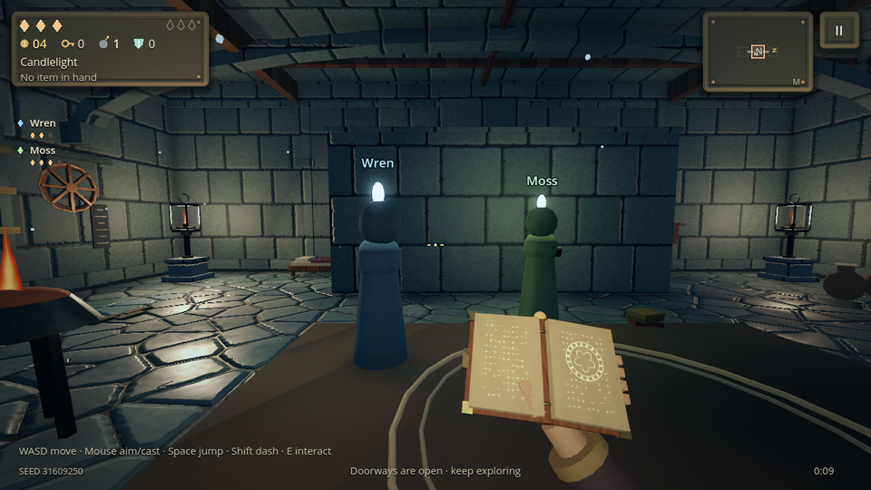
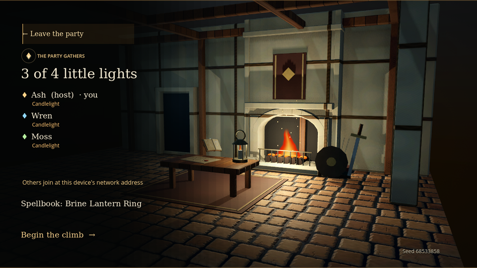
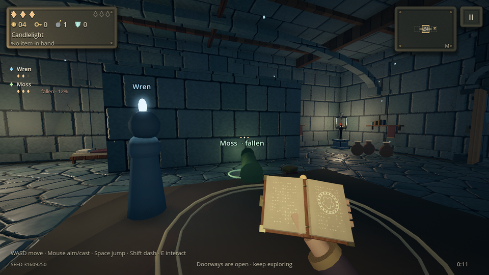

# Co-op

Two to four players can climb the tower together on the same local network. Each player plays on their own device, with their own first-person view. A party can clear all five floors. Every player keeps their own hero, health, wallet and loot.

## Playing together

1. Everyone joins the same network: the same Wi-Fi, a phone's hotspot, or a wired LAN.
2. One player chooses **Climb together** on the title screen, then **Host a party**. The lobby shows the host's address, for example `192.168.1.23`.
3. The others choose **Climb together**. Parties found on the network appear as **Join** buttons. If none appears, type the host's address and choose **Join**.
4. Each player picks their spellbook in the lobby (**Spellbook: …** cycles through the seed's four).
5. Once at least two players are in, the host chooses **Begin the climb**. Everyone starts the same tower from the host's seed.

The game uses UDP port 47620 for play and ports 47621–47622 to find parties. Windows may ask once whether Emberkeep may use the network; allow it on private networks.

## Rules

**Personal loot.** Every player sees and collects only their own drops: coins, hearts, keys, bombs, wards and batteries. When a foe falls, each player gets their own drops from it. Room-clear supplies, chests, breakable props, reliquaries, shops, the rest hearth and Death's altar are each player's own too. Death's trials are each player's own too, taken one at a time: while one player fights theirs, everyone else spectates. Spectators cannot cast, dash, interact, pick anything up or be harmed, foes see only the challenger, the doors stay shut until the trial is done, and the challenger sees them pale and translucent. A spectator's screen shows whose trial it is and how it stands. The host raises a guest's trial foes and tells that guest when each wave has fallen. A challenger who falls in a co-op trial fails it instead of going down, and is left on one heart. Every player gets their own relic choice at every reliquary, drawn separately from the others'. Each player has their own spellbook, relics, held item, health, wallet and kindle.

**Shared world.** Foes, spells in flight, residue on the floor (wax, fire, ice, water, moss, ink, glass and spore clouds), fire vents and pendulums, bombs, broken props, hidden passages and lanterns are the same for everyone. A foe chases the nearest teammate who is still standing. A slam or burst aimed at one player also catches any teammate at least as close to it.

**Falling and rekindling.** A player whose last heart goes falls where they stand. Their view drops to the floor and the screen shows *You have fallen*. Foes leave a fallen player alone. A teammate who stands beside them for three seconds rekindles them, and they return on one heart. A ring at the fallen player's feet and a bar on their screen show the progress, which slowly fades if the teammate steps away. The climb ends only when everyone is down at the same time. A player still down when the party climbs the stair is rekindled and climbs with them.

**Moving on together.** Doors open when a room's fight is won, for everyone at once. A passage between rooms has a turn halfway along. Nobody passes the turn until the whole party (everyone still standing) is in the same passage. A player waiting at the turn sees who the party is waiting for. When the last player steps in, the next room loads for everyone. Anyone lagging behind in the passage is carried just past the turn, and anyone fallen is brought along. A fight starts once the whole party is through the door, or three seconds after the first player enters. Anyone still in the passage is then pulled into the room.

**The stair.** When the boss falls, each player's stair rises. A player who chooses to climb waits at the stair (*Waiting at the stair · 1 / 3*); walking away stops waiting. The party climbs together once everyone standing is waiting, and arrives side by side on the next floor.

**Menus do not stop the tower.** Pausing, the journal, the map, a painting and the reward screens stop only your own player. The fight goes on around you.

**Not saved.** A co-op climb lives only as long as its party. It is never saved, and a solo save stays as it was. If the host leaves, the climb ends for everyone. If a guest leaves, the others carry on. After a climb ends, the host can choose **Climb again together** to return the same party to the lobby.

## How it works

`Session` (`scripts/session.gd`) is the transport. It runs ENet on port 47620. Every message carries a kind and a payload, sent reliably and in order, or unreliably for state that the next update replaces. A guest takes messages only from the host. The host lets a guest in only when the protocol version and the content revision match, the party has room, and the climb has not begun. `LanDiscovery` (`scripts/coop/lan_discovery.gd`) finds parties in two ways:

- A host answers broadcast queries and announces itself once a second.
- A guest both listens for announcements and asks.

Phones often filter incoming broadcasts, but the host's direct answer still reaches them. When neither gets through, typing the address always works.

`Party` (`scripts/coop/party.gd`) is the game side. Each device runs its own player exactly as a solo climb does: movement, casting, health, relics, pickups, chests, rewards and the map. The host runs everything the party shares.

- **Floors.** The host builds each floor from the seed and sends it, compressed, so every device walks exactly the same rooms. Each player's own paintings, offers and drops are then laid on their own copy.
- **Players.** Each device reports its player about 30 times a second: position, facing, health, whether it has fallen, and where it stands in a passage. The host stands a figure (`scripts/coop/party_member.gd`) in for each guest. Foes chase these figures, and what strikes a figure is sent to its player as a blow. The host sends everyone's figures back, so each player sees the others: a hooded figure in its party colour, with a flame on its head, an open book in its spellbook's colour, and its name above it.
- **Foes.** The host's foes are drawn on each guest's device as puppets of the same kind (`DungeonEnemy.puppet`). A puppet glides to the host's position, mirrors the parts of its body that move and the telegraph geometry it makes (warning rings, landing marks), and shows the host's health. Anything a guest does to a puppet goes to the host, which applies it: a blow, a status, a slow, a shove or a dash through a ward. Foe updates go out 20 times a second. Each update sends only what moved and is split to fit network packets.
- **Spells.** A guest's own spell is drawn at once and also sent to the host, which casts the real one as that guest's. The real spell decides every hit. The guest's hit marker, lifesteal and returning books follow the guest. Everyone else's spells and every hostile spell are drawn from the host's, and a teammate's casting is heard where they stand.
- **Everything else.** Effects, sounds and damage numbers from the shared world are replayed on guests. They go unreliably, so a lost spark never delays the world's changes. Residue changes travel tile by tile. Kills, cleared rooms, the start of a fight, broken props, revealed passages, lanterns and bombs travel as reliable events. Each guest grants its own rewards for them.

Every position is room-local. A passage handoff or a new floor moves the origin, so reports carry the count of handoffs so far. A report from just before a handoff is shifted into the new frame, and anything older is ignored.

## Platforms

- **Android.** The APK now requests internet, network state, Wi-Fi state and Wi-Fi multicast permissions, all needed for local play. The game has no online services and sends nothing beyond the local network.
- **iOS.** The first co-op use shows iOS's local network prompt, which the export's `NSLocalNetworkUsageDescription` explains. iOS does not let apps send broadcasts without an entitlement from Apple, so an iPhone or iPad usually joins by typing the host's address.
- **Desktop.** Hosting and joining work alike on Windows and Linux. Two copies of the game on one computer can play together through address `127.0.0.1`.

Co-op is first-person only; the legacy isometric view (`--isometric`) stays single-player.

## Limits

- Latency matters little on a local network. Each guest still sees foes a few hundredths of a second behind the host, so a hit that looks close may miss, and the host's verdict stands.
- Foe animation is mirrored by moving parts and Geo-built telegraphs. A foe that changes a material or a shader parameter (a vent's glow, a cone's tint) looks simpler on a guest than on the host.
- There is no rejoining a climb in progress, no internet play and no voice or text chat.

## Verification

`tests/coop.gd` runs a real three-player climb over the loopback network. The test hosts in its own process and starts two more game processes (`tests/coop_guest.gd`) that join, each with its own storage. Together they check:

- the handshake's rules and LAN discovery
- the shared floor, and guests seeing the host and each other where they really are
- waiting at a passage's turn until the whole party is in, then moving on with the lagging player pulled along
- the fight starting once the party is in, with every host foe drawn on the guest
- a guest's blow and spell applied on the host as the guest's, and the other guest seeing that spell
- foes chasing the nearest teammate
- personal kill credit
- a blow on the guest's figure landing on the guest alone
- falling, being left alone by foes, and being rekindled on one heart
- the stair waiting for the whole party (walking away stops waiting), then everyone arriving on the same floor in the same room
- the climb ending only when everyone is down, without a save, and the host bringing the party back to the lobby

It is part of `tools/test.sh`. `tests/render_coop.gd` is an opt-in native capture of the lobby, two teammates in a room, a fallen teammate being rekindled and a player's own fallen view. Set `EMBERKEEP_COOP_CAPTURE` to an output directory and run it under a display or Xvfb.
