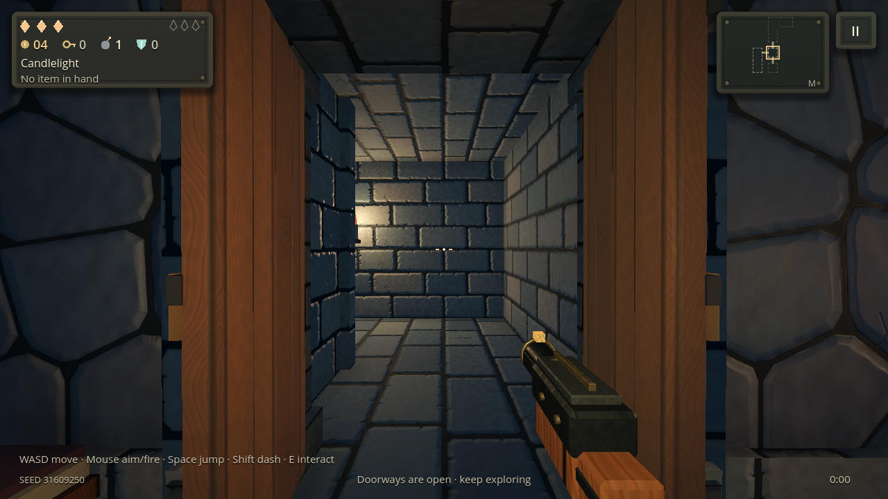
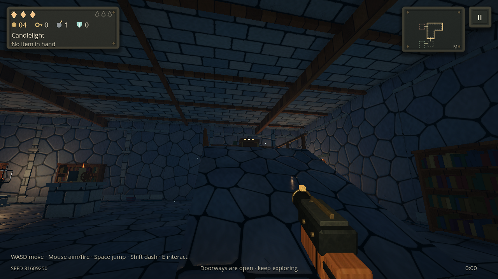
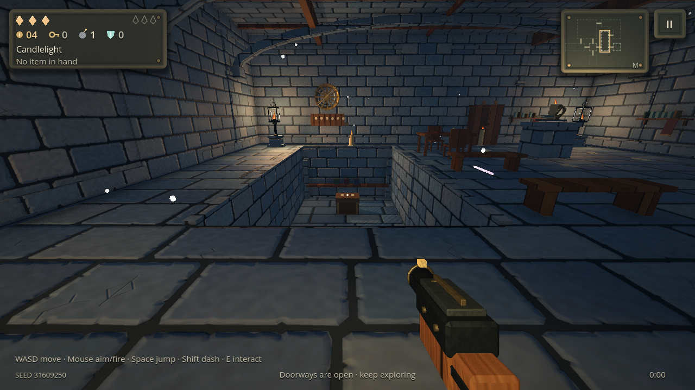

# Walkable corridors and reliable vertical rooms

2 November 2026 · `experiment/stylized-lighting` · Godot 4.7.2 Standard · Compatibility renderer.

## PowerVR ambient occlusion

The SSAO setting now works on PowerVR independently of the scene-color post-processing switch. Low uses six depth samples and High uses eight on this policy; other devices retain eight/twelve. Off removes the pass. It reconstructs contact occlusion from depth in one draw, with no reflection camera, color copy, temporal history or MSAA requirement. Background normal reconstruction guards against zero-length derivatives.

The other Pixel safeguards remain: mobile MSAA is disabled, the main pixel budget is 1280×720, and PowerVR keeps the expensive reflection/radiance, refraction and bloom paths disabled. This change enables SSAO; its sustained cost still needs measurement on the actual phone.

## Real corridors

Each portal owns a deterministic, reversible corridor blueprint. Its orthogonal path extends beyond both room footprints, then bends through opaque stone elbows. Floors, walls and ceilings have matching physical collision. Doorway views show the actual first bend, with warm wall candles, instead of an empty black opening.

Walking no longer invokes the first-person fade/teleport transition. The same player, camera and active corridor continue moving. A coordinate rebase behind the central bends adopts one prepared neighboring room while preserving velocity, aim, cooldowns, invulnerability and in-flight corridor projectiles, including their launch origins and trails. Lit bombs retain the same view, authoritative record and remaining fuse in the new coordinate frame. The aperture is hidden across the full capsule-width handoff band, including a dash step and a view aimed backwards. Adjacent doorway previews cannot intersect the walking route.

Only one complete corridor and one hidden neighboring room are prepared. Corridor geometry uses two merged material batches and two unshadowed candle lights, with separate lighting layers so a room replacement cannot change the corridor's shading. Staging restores the active room's particle pool and shader mask. Adoption reconnects the particle pool's live settings listener.

An uncleared encounter begins when the player actually enters the chamber. The entrance remains usable while approaching through its corridor, then seals for combat. Backtracking before arrival works. Checkpoints store a safe position inside the current room, so a resumed run cannot start outside its room without a connector.



## A visible upper chamber or cellar on each new floor

The old planner reserved optional lanterns before the architecture. Together with the large reward-pedestal exclusion, those reservations rejected many eligible plans after the nominal chance check.

The generator now reserves the vertical space first, relocates optional lanterns deterministically, and furnishes the remaining space. A new floor must contain a valid primary two-level combat chamber on its normal boss route; bounded retries use the existing compact fallback when necessary. Floor one guarantees an upper annex at +2.8m, floor two a cellar at −2.6m, with alternating primary types thereafter and additional eligible chambers still rolled separately. These remain compact towers with dense furniture and internal partitions.

Clearing the chamber supplies its existing normal chest at the upper/cellar destination, with the ordinary equipment chance. Active items remain chest-exclusive. Continued modern saves with no valid vertical chamber can repair one untouched room; visited rooms, opened chests, collected items, the floor graph and gameplay RNG are preserved. Start a new run to see the guaranteed main-route generation on every floor.





## Supported architecture

Vault ribs are emitted only across cells that have actual supporting walls on both sides. Their ends join stone corbels, their segments overlap, and their keystones meet the ceiling. Coffers join the ceiling and neighboring cells; stair-shaft openings also cut the timbers. Upper guards have posts and annex shelves meet their supporting columns. Wide-room internal seams no longer carry disconnected half-arches.

## Verification

`tests/corridors.gd` passes **5,334 checks**: 32 generated floors including seed **31609250**, guaranteed main-route levels, serialized/reversible connectors, separated doorway previews, supported architecture, old-save repair, complete aperture occlusion, retained player/projectile state, hidden staging, live effects settings, combat entry and actual capsule traversal in all four doorway orientations. Existing physical upper/cellar traversal and chest transaction tests remain in the full runner.

The full local 32-suite run passed **168,151 checks with zero failures**. The final bomb-continuity and idle-door-lighting changes then passed the 5,334-check corridor suite and all 54 doorway checks. The legacy pendulum fixture now keeps its damage target stationary instead of depending on whether its AI leaves the swing before contact.

The native OpenGL capture rendered nine views under the simulated PowerVR policy, including upper and cellar rooms, SSAO Off/Low, the upper landing and a corridor loading comparison. With HUD and held-weapon animation excluded, mean RGB change during the atomic handoff was **0.00000621** on a 0–1 scale. The entire player and camera survived the step. There were no script, shader or framebuffer errors.

The reported seed's upper-room view measured 317 draw calls, about 27.18 MB texture memory and 34.38 MB total video memory. The cellar measured 599 calls / 27.17 MB / 34.51 MB. These are scene workload measurements on Mesa llvmpipe, not Android frame-rate claims. See [native measurements](reports/corridor-powervr.json) and [the regression record](TESTING.md).

To reproduce with disposable user storage and an OpenGL display:

```sh
GODOT_BIN=/path/to/Godot_4.7.2 bash tools/test.sh
GODOT_BIN=/path/to/Godot_4.7.2 bash tools/verify_pack.sh
XDG_DATA_HOME=/tmp/emberkeep-corridor-test EMBERKEEP_CORRIDOR_CAPTURE=/tmp/emberkeep-corridor-views godot --path . --audio-driver Dummy --script res://tests/render_corridors.gd
```
