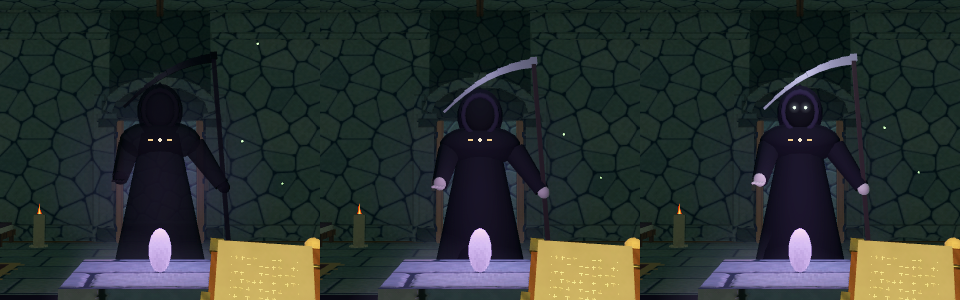
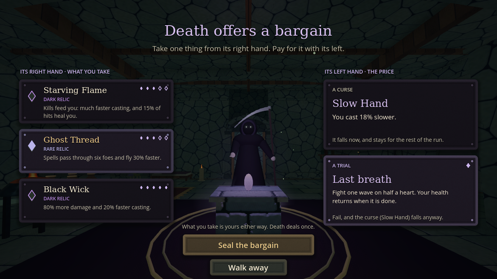

# Death's bargain

The dark room no longer takes health. Death waits behind its violet altar instead and offers one bargain.

## Death

Death stays unseen until you come within a few steps of the altar, or have spent a few seconds in the room. Then it rises out of the dark:

1. Mist gathers at the altar, and a faint glow behind it.
2. A black shape stands up in the mist: a hooded figure holding a scythe.
3. The robe, the bone of its hands and the steel of the blade come into the light.
4. Last, two small white eyes open in the hood, with a faint glow.

It turns slowly to watch you. Once a bargain is sealed it goes back the same way: eyes first, then its colours, then its shape and the mist.

## The bargain

Interact with the altar and the bargain screen opens, with Death still visible between its two hands.

**Its right hand: what you take.** Three offers, the same ones the dark store had:

- one of the eight dark relics,
- a dark-forged spellbook (a third trait) or a precious relic,
- a second dark relic.

Each shows its power, 2 to 5.

**Its left hand: the price.** Choose one:

- **A curse.** A permanent weakness for the rest of the run, as heavy as the offer is strong: 6% for each point of power, so 12% to 30%. Heavy Chains weigh half as much again.

  | Curse | What it does |
  | --- | --- |
  | Withering | Your spells strike weaker |
  | Slow Hand | You cast slower |
  | Leaden Feet | You move slower |
  | Heavy Chains | Your dash takes longer to return |
  | Short Reach | Your spells fly less far |

- **A trial.** Win it and no curse falls. Fail it and the offer's curse falls anyway.

  | Trial | What Death asks |
  | --- | --- |
  | Waves against the clock | Clear three waves of foes in this room within 60 seconds |
  | Reaper's quarry | Kill a champion (an elite with far more health) within 30 seconds |
  | Soul harvest | Catch seven soul-wisps within 40 seconds while foes hunt you |
  | No dashing | Win your next fight without dashing once |
  | Last breath | Fight one wave on half a heart; your health returns when it is done, and falling ends the trial, not the run |

Each offer comes with its own curse and its own trial, both drawn from the room's seed. Whatever you take is yours as soon as the bargain is sealed, whichever price you choose. Death deals once per altar. You can walk away and come back later.

Every trial except No dashing is fought at once in Death's room, with the doors shut. Foes Death raises carry no loot. Leaving the run in the middle of one counts as failing it. No dashing waits for the next fight to shut its doors, even on a later floor.

Your curses are listed under your relics, and in full on the pause screen.

In co-op Death sets only No dashing, the trial that raises no foes of its own.

Runs saved before this update keep the maximum health they gave the old dark store.

## Code

- `scripts/items/death_bargain.gd`: the curses and trials, and the terms each offer gets.
- `scripts/items/death_trials.gd`: trials being fought, won and lost.
- `scripts/presentation/death_figure.gd`: Death's figure and how it rises and fades.
- `main.gd`: `open_bargain()`, `seal_bargain()` and `ensure_dark_offers()`.
- `Run`: `curses` (applied in `rebuild_stats()`), `trial`, `add_curse()`, and both saved with the run.
- `ui.gd`: the bargain screen, the trial line in the HUD and the curse list.

`tests/tower.gd` checks the offers, curses, every trial won or lost, saves and co-op. `tests/render_death.gd` is an opt-in capture; set `EMBERKEEP_DEATH_CAPTURE`.
