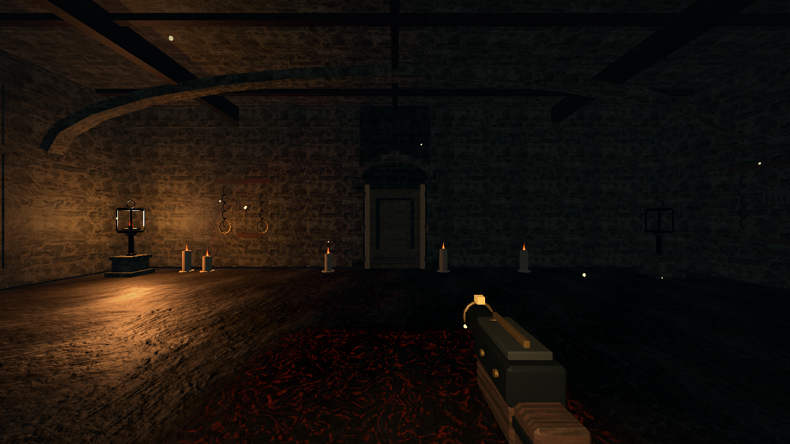
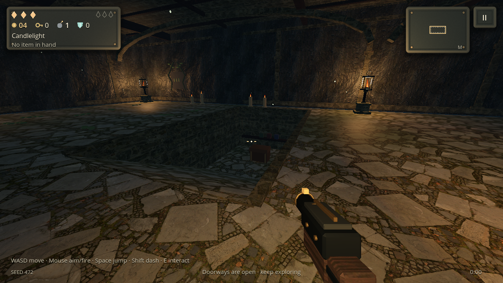
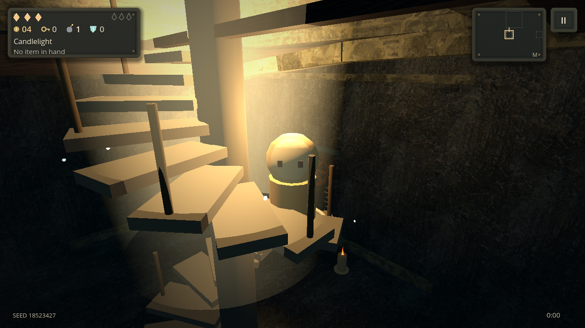

# Expedition update — 0.5.0

The tower now has fewer, more purposeful rooms, optional vertical spaces and a scarcer reward economy. Physical doors, denser interiors, contact shading and an actual third-person stair climb address the presentation problems alongside the gameplay changes.

## Compact, inhabited rooms

Generator v3 creates 9–11 rooms per floor including its secret room. Boss and painting/rest rooms remain guaranteed. Treasure and shop opportunities each have a 70% chance; dark stores have a 35% chance after the first floor. More of the compact tower is occupied by encounters instead of mandatory reward stops.

Fifteen furniture compositions include guard posts, supper halls, bunkhouses, apothecaries, armories, cloisters, engine rooms, archives and pilgrim stops. Placement resolves furniture clusters around seeded masonry partitions, doorway approaches, light fixtures, chests, painting views and stairs. Wall and prop records are saved with each room. Existing v2 floors retain their original generation and furnishing streams.

Across 36 generated v3 floors, the layout suite found 623 internal walls, 32 upper/cellar annexes and all 15 compositions. The samples averaged 4.28 combat rooms per floor and 21.34 furniture records per room. Tests check normal and boss-width routes, required destinations, valid saved wall records and actual runtime vertical reservations. A compact deterministic fallback preserves the new room-count contract if retries are exhausted.

## Upper annexes and cellars

Eligible multi-cell combat rooms have a seeded chance to gain a safe upper annex (+2.8 m) or cellar (−2.6 m). A 4.6×4.2 m landing and broad physical ramp create an additional usable level. The cellar cuts the original floor and foundation rather than placing a lower room beneath a solid sheet. Saved blueprints retain their resolved geometry; invalid or unbounded records cannot generate unsafe depths.

Players and enemies use the same floor heights and navigation constraints. Physical tests cover walking and jumping up/down both types, AI pursuit in both directions, and the earlier gallery/ramp regression. Residue, steam, spore damage, loot and interactions respect elevation. Magnets cannot pull pickups through a wall or floor.

Clearing one of these rooms awards **one normal unlocked chest**, placed on its actual level. It has an 18% active-equipment chance, rather than guaranteed equipment. Room-clear credit, reward type and the stable chest record are saved together. Repeated clear notifications and reloads cannot duplicate that chest or its contents.

## Separate rewards and a harder economy

Active items now come only from chest transactions. Enemies, breakables, ordinary room rewards, shops and dark-store offers cannot generate actives. Unopened old active offers convert deterministically to passive relics; carried actives, swapped instances and their cooldowns remain usable. Weapons and passive relics retain their own offer channels.

New expeditions use versioned scarcity rules:

| Rule | Earlier runs | New expeditions |
| --- | ---: | ---: |
| Starting coins | 8 | 4 |
| Average ordinary enemy coins | 0.4 | 0.2 |
| Ordinary enemy half-heart chance | 10% | 3% |
| Room-clear half-heart chance | 40% | 12% |
| Boss coins | 12 | 5 |
| Boss full-heart chance | 100% | 35% |
| Rest healing | 3 | 1 |
| Free healing on floor change | 2 | 0 |
| Ordinary combat relic awards | Every second clear | At most one per floor |
| Gilded coin shedding | Up to 4 | Up to 2 credited coins |

Boss rewards and optional treasure rooms remain distinct from the ordinary-combat relic budget. Breakable and chest supplies are also reduced. The deterministic economy test measured 2,011 versus 3,997 coins over 10,000 ordinary foe rolls; normal chests produced active equipment in 686 of 4,000 rolls.

Difficulty increases through one or two additional encounter participants (bounded at 16), modest health and movement changes, and 10–22% higher attack cadence by depth. Bullet damage and visible windup duration are preserved, and entering players retain a reaction window. Movement speed is not accidentally multiplied by the new cadence a second time.

## Physical doors and grounded fire

Open doorways show a short enclosed stone connector, worn threshold and real wooden/iron leaves in an open pose. Combat shows the closed leaves. The connector hides the unloaded room beyond, while the original reciprocal portal triggers still handle travel. It adds no extra local lights or shadow passes. Tests move the real capsule through all four orientations and across a paired doorway.

Floor fire uses dark scorched crust, irregular restrained hot fissures and a cooled edge. It retains the exact authoritative damage mask and adds no per-tile meshes or lights. Vents avoid internal walls, furniture and split-level annexes.

## Fullscreen and SSAO

Settings → Display adds desktop fullscreen with restored window size/position when returning to windowed mode. Mobile platforms retain their system-managed fullscreen behavior.

Settings → Graphics adds SSAO Off/Low/High. This is a real depth-based Compatibility pass with 8/12 bounded samples and one fullscreen draw, before the HUD. It alpha-blends contact darkening instead of sampling/re-tonemapping scene color. Native checks measure contact darkening while a zero-intensity pass and HUD patch remain unchanged. At 1280×720 it adds one draw and about 3.52 MB of depth-buffer memory, with no history buffer or extra viewport.

The existing PowerVR safe policy keeps SSAO disabled and explains that state in Settings. Mobile MSAA, pixel-budget and expensive-screen-pass safeguards remain intact. Desktop GL captures validate the supported path; these measurements do not claim physical-phone performance.

## Stair-climb presentation

Using the exit stair holds the approach for a 0.72 s camera pullback, then follows the visible character up the scripted spiral. The next floor shows the character emerging and returns smoothly to the first-person eye. The existing camera is reused; collision retracts its shoulder view before walls and furniture, and ceiling shafts make room for the upper steps.

The sequence advances on the simulation clock, pauses without drift and restores camera FOV, aim, avatar/weapon visibility and input on arrival or cancellation. The crosshair, combat status and touch action controls hide during the climb; pause remains available. Integrated tests exercise the actual main-scene climb, floor change and arrival, alongside seven native keyframes.

## Saves and verification

Start a **new run** to use generator v3 and the new economy. Existing generator-1/2 runs continue with their original topology and balance; permanent collections are preserved. Door rendering, fullscreen and supported SSAO also work when continuing an older run.

The regression runner now includes 30 suites, with 161,692 completed checks and zero failures. Focused coverage includes 24,423 layout checks, 359 split-level checks, 181 reward checks, 23 full game/reload transaction checks, 50 door/fire checks, 18 SSAO/fullscreen checks and 33 stair-camera checks, plus the existing gameplay/navigation/stress suites. The exported Linux resource pack passes catalog/material validation and 600 quickstart frames. All four native export workflows passed after repeating the complete 30-suite run. Verified artifacts are linked below.

## Native captures

Compatibility captures under the simulated PowerVR policy:

## Verified native builds

All four Godot 4.7.2 workflows succeeded for source commit `6c37f390d4453ab008e933a68d15636086d635d3` on 2026-11-01. Android and AppImage CI each recorded **30 suites / 161,692 checks / zero failures** before validating their packaged games; Windows and iOS also completed their full test and export jobs successfully.

| Build | Download artifact | Workflow |
| --- | --- | --- |
| Android Preview | [Emberkeep-Preview](https://github.com/Halty323/emberkeep/actions/runs/41346324752/artifacts/13099218971) | [Android APK](https://github.com/Halty323/emberkeep/actions/runs/41346324752) |
| Android standard | [Emberkeep-Android](https://github.com/Halty323/emberkeep/actions/runs/41346324752/artifacts/13099821084) | Same Android job |
| Linux x86-64 | [Emberkeep-Linux-AppImage](https://github.com/Halty323/emberkeep/actions/runs/41346324874/artifacts/13099292285) | [Linux AppImage](https://github.com/Halty323/emberkeep/actions/runs/41346324874) |
| Windows x86-64 | [Emberkeep-Windows](https://github.com/Halty323/emberkeep/actions/runs/41346324867/artifacts/13099032885) | [Windows build](https://github.com/Halty323/emberkeep/actions/runs/41346324867) |
| iPhone/iPad | [Emberkeep-iOS-unsigned](https://github.com/Halty323/emberkeep/actions/runs/41346324751/artifacts/13099736369) | [iOS unsigned IPA](https://github.com/Halty323/emberkeep/actions/runs/41346324751) |

Unzip each artifact first. Both APKs use `0.5.0-android.100009` (code 100009), the existing standard/Preview package identifiers and the same cached development signing certificate as the previous release. CI verifies signatures, native-library alignment, catalog/material inclusion and 240 packaged quickstart frames. The downloaded Preview checksum is `5e43e650ce0be3c58d18fdee9a6aabfa735e86170ec4d638861bc19df705d355`; it matches the CI report. The downloaded AppImage also passes its supplied checksum.

Artifacts follow the existing retention periods; rerun their workflow when an artifact expires. iOS requires personal signing for installation. Physical-device balance, sustained performance and touch comfort still need playtesting; the native GL figures above describe the tested workload only.
