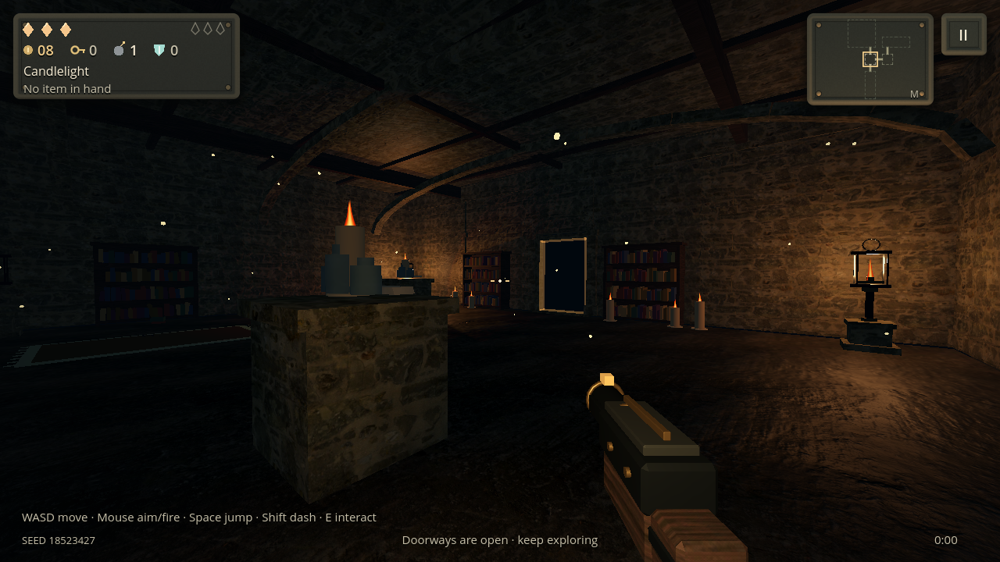
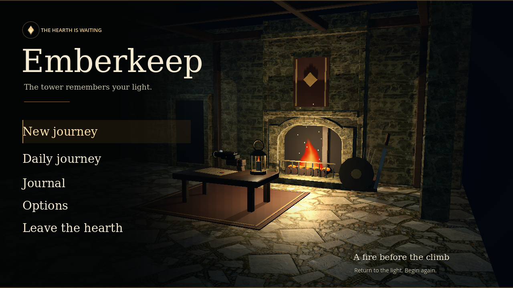

# Lighting and material update — 0.4.0

The first-person presentation now centers on real fixture light and high-resolution materials. It replaces the earlier PS2-style painted surfaces rather than enlarging them. Warm flames shape the architecture against cool ambient shadows; roughness, normal detail and occlusion supply surface depth without an extra rendering pass.

## Materials

Four genuine ambientCG materials supply weathered masonry, irregular flagstone, dark rock and aged wood. Each uses original 2K color/OpenGL normal maps plus a packed AO/roughness/metallic map. Two source materials are 2:1; texture aspect is preserved and the shader compensates its world-space UVs. Surface normals use a consistent tangent frame on both positive and negative wall faces, and reconstruct normal Z for compressed GPU formats.

Desktop loads the 2K maps. Android/iOS and the simulated PowerVR policy load 1K derivatives of those same originals, with renormalized mobile normals, mipmaps and VRAM compression. The packed physical map is shared between variants. Runtime caches are bounded by four families, and loading textures does not advance gameplay RNG. There is no network dependency in play. Dry stone has a roughness floor; wet themes retain stronger localized highlights.

The sources are **Bricks096**, **PavingStones149**, **Rock020** and **Wood051**, released under CC0. [Material provenance](../assets/materials/pbr/README.md), exact source/archive/output hashes and dimensions are bundled with the source. `python3 tools/import_dungeon_materials.py --check` verifies all 20 derivative files offline. Bundled source images total 23.71 MiB; GPU residency differs by device format and selected variant.

Ground, walls, ceilings, joists, gates, candle plinths, reward bases and the hearth use the new finishes. Earlier original material sheets and their authoring command remain reproducible as a separate historical path.

## Lighting and presentation

First-person lighting derives a copy of each floor's existing gameplay profile. The copy reduces the broad directional fill, keeps a cool visibility floor and strengthens actual warm fixtures. The climb still brightens with height; enemy readability, burning-lantern membership and the damage-in-light mechanic are preserved. Ambient light no longer overrides the floor with a flat blanket.

Lanterns have an open iron/brass cage and a depth-tested flame card instead of an opaque emissive yellow cube. Soft turbulent flame shapes replace the three pointed fire tongues. Fake lantern/candle/marker floor halos are hidden in first person, and open-door trim glows gently instead of bleaching white. Subtle flicker animates existing lights. First-person post grain is reduced so material detail stays clear.

The hearth scene uses three motivated local lights: warm fire, a cool doorway and the table candle. A heavier chimney silhouette and beveled masonry/timber catch highlights. Its one optional shadow is softened. The armament description has a dark backing over moving highlights. The weapon model retains three draw surfaces and its existing rig, with scanned wood, dark iron, narrow brass fittings and an ember accent.

## Budgets and compatibility

The existing PowerVR safeguards remain: no mobile MSAA, no costly screen-copy/refraction/reflection path on the affected driver, and the same bounded 3D pixel budget. Rooms retain at most five active lantern fills and one local shadow spotlight. The update does not add cubemap shadow lights, reflection viewports, screen-space AO or runtime GI baking.

Native Compatibility captures use real generated rooms, collision-clear eye positions and frozen encounters. The interior-only fixture now removes frozen combat actors before placing the camera: the earlier huge tan plane in Kiln/Hearth captures was a brute intersecting the capture viewpoint, not a terrain defect. The new fixture covers a cellar room, Cistern L bend, raised Halls gallery and wide Kiln workshop, with separate desktop/PowerVR policy captures and JSON resource measurements.

The complete **23-suite** run passed **136,774 checks** with zero failures, followed by the painting importer's offline checks and all 20 PBR asset hash/provenance checks. The lighting suite contributes 55 checks, material coverage 147, and the existing navigation/stress suites remain in the run. The held caster has 1,508 triangles and three draw surfaces.

The four scene captures measured approximately 18.32 MB texture residency and 25.2–25.5 MB total video memory under the simulated PowerVR policy. The desktop path uses 2K maps and the existing post-processing stack: approximately 63.27 MB textures and 70.3 MB video memory. All eight floor-theme captures passed without shader/framebuffer errors.

See [TESTING.md](TESTING.md) for reproduction details and packaged-build results. Desktop software rendering validates the paths and resource bounds; sustained Pixel frame time and the final device appearance require a physical playthrough.

## Captures

Native Godot 4.7.2 Compatibility captures under the simulated PowerVR policy, at 1280×720:

## Verified downloads

All four workflows passed for source commit `73cf8614cd54cf9eb67ec4c83cb1dc80988f1298` on 2026-11-01. Each native job repeated the complete 23-suite regression run before checking the actual exported game.

| Build | Download artifact | Workflow |
| --- | --- | --- |
| Android Preview | [Emberkeep-Preview](https://github.com/Halty323/emberkeep/actions/runs/41294376495/artifacts/13078393828) | [Android APK](https://github.com/Halty323/emberkeep/actions/runs/41294376495) |
| Android standard | [Emberkeep-Android](https://github.com/Halty323/emberkeep/actions/runs/41294376495/artifacts/13077933410) | Same Android job |
| Linux x86-64 | [Emberkeep-Linux-AppImage](https://github.com/Halty323/emberkeep/actions/runs/41294376531/artifacts/13078199097) | [Linux AppImage](https://github.com/Halty323/emberkeep/actions/runs/41294376531) |
| Windows x86-64 | [Emberkeep-Windows](https://github.com/Halty323/emberkeep/actions/runs/41294376536/artifacts/13078293917) | [Windows build](https://github.com/Halty323/emberkeep/actions/runs/41294376536) |
| iPhone/iPad | [Emberkeep-iOS-unsigned](https://github.com/Halty323/emberkeep/actions/runs/41294376499/artifacts/13078592331) | [iOS unsigned IPA](https://github.com/Halty323/emberkeep/actions/runs/41294376499) |

Both APKs are `0.4.0-android.100007` (code 100007), with the existing standard/Preview package identifiers and development signing certificate. Signature, native-library alignment, content/material validation and 240 packaged quickstart frames pass for both. The downloaded Preview APK matches SHA-256 `f204e924e594cc11cb64898add1fabd9dc76c1a2d7e08401ff2bb1ae7b322252`; the downloaded AppImage also passes its supplied checksum. The standalone Linux resource pack passed material/catalog validation and 600 quickstart frames locally.

Artifacts follow the existing retention periods; rerun the linked workflow after they expire. The unsigned iOS build needs personal signing for installation. No physical Pixel/iPhone performance result is claimed by these export checks.
