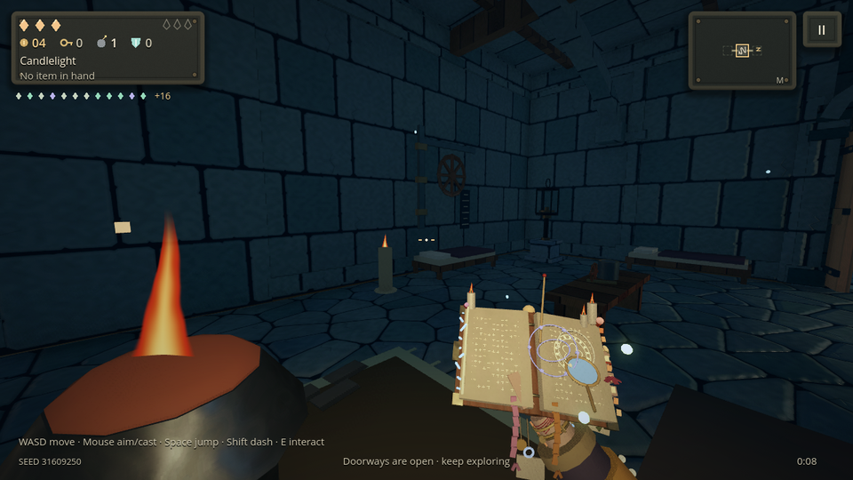
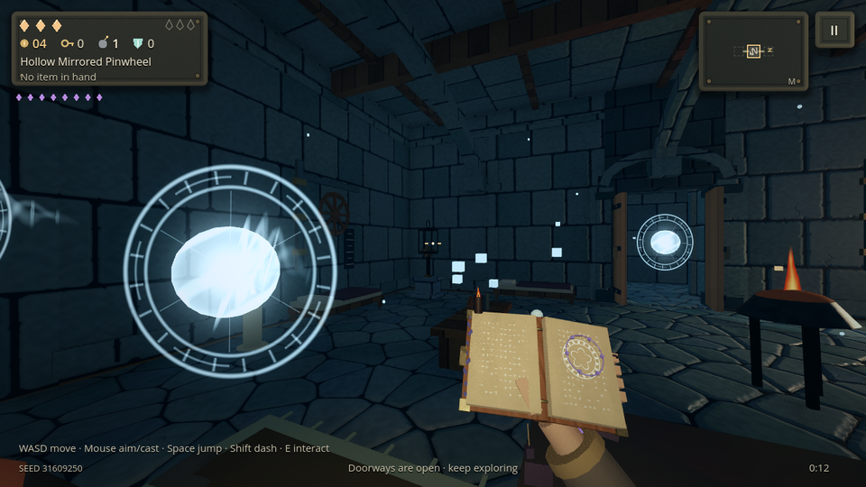
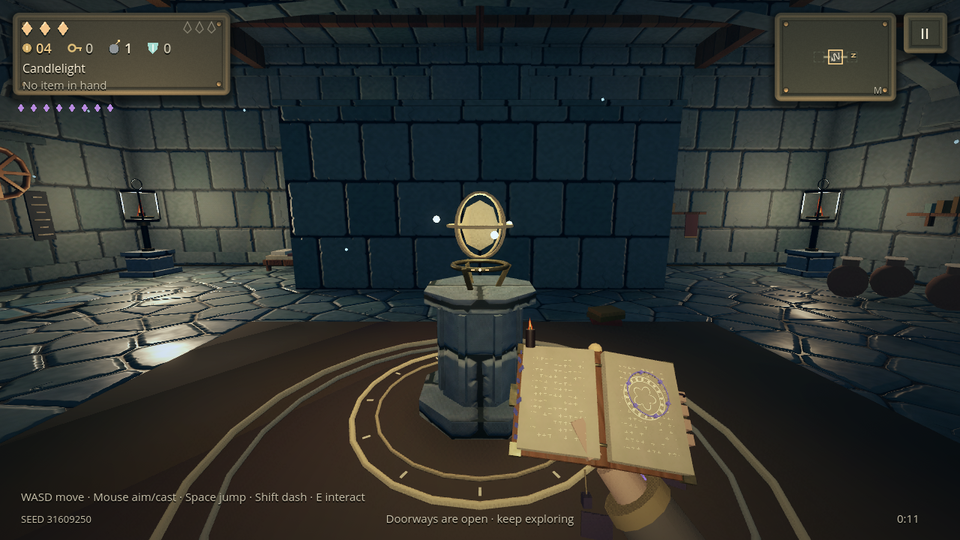

# Magic update

The little light no longer carries a gun. It holds an open spellbook and casts. Every relic it finds adds a mark to that book or to the arm holding it. Relics are now rarer and stronger. They wait in a reliquary instead of on a tilted glowing cube.

## The spellbook

In first person, the right hand holds an open book low in the view:

- wooden boards with brass corners, a clasp and spine bands
- parchment pages, with a gem set in the spine
- the forearm in its robe sleeve below

The pages are written in the spellbook's own colour: rows of glyphs, and a turning circle of power on the right page (`shaders/spell_page.gdshader`). The writing flares on every cast. A cast pushes the book forward, sends a drift of sparkles from it, and rings a short rising chime instead of a gunshot.

The forged weapons are now spellbooks. They keep their seeded names, patterns, elements and balance. Their descriptions say what they cast, for example "Casts a wide spray of motes that set foes burning." The UI, tutorial, touch controls (CAST), boss warnings and lore now use spells and casting.

## Every relic marks the book or the arm

`scripts/items/spellbook_looks.gd` gives each of the 68 relics its own mark. Relics of the same kind take separate places, so a collection builds up visibly:

- **Book:** candles on the boards (twin wicks, a stub, a crown of tiny candles, a black candle), gems in the brass corners, hanging ribbons and charms (coin, stones, moon, snowglobe, firecracker, honeycomb, bottle, lantern), turning sigils over the pages, orbiting motes, frost, embers, moss or glass along the edges, gilt or glowing page edges, a tucked match or splinter, a lens, pressed flowers.
- **Arm:** rings, bangles (one strung with coins), wraps of cloth, thread and copper wire, iron, amber or frost bracers, glowing tattoos and a hunter's mark, a watch, moth wings at the cuff, a thorn vine, a leather glove, velvet or ash sleeves.

Static marks merge into two meshes, one lit and one glowing. Only sigils, motes and candle flames move. The marks are rebuilt when the inventory changes.

## Spells, not bullets

A spell is no longer a white-hot ball with a straight tracer. Each one is:

- a swirling orb in its own colour, with light running round it
- a turning rune circle facing the camera, with rings, rune ticks and spokes
- two wisps twisting round each other behind it, flecked with sparkles

The floor glow beneath carries the faint ring of the sigil. Spells of one colour still share materials, so this costs no more than before.

## Rarer, stronger relics

- **Fewer relics.** Ordinary fights no longer award a relic; they pay in supplies and chests. A floor's relics come from its boss, its treasure room and the shop. A typical floor now yields about two relics instead of three.
- **Higher shop prices.** Relics cost about half as much again: 12, 18, 26 and 36 coins by rarity.
- **Stronger effects.** Every relic's effect is about 1.5 times what it was. Most drawbacks on common and uncommon relics are gone. Warm Wax gives +35% damage, Heartstone two hearts, Splinter two extra pierces and Glass Sun ×2.5 damage. Firefly Jar now carries two fireflies and Tiny Planets four.
- **Renamed relics.** Brass Barrel is now Brass Lens, and Rear View is now Backward Glance. Relic ids are unchanged, so saves keep their relics.

## The reliquary

Relics wait in a reliquary (`scripts/items/reliquary.gd`):

- an octagonal carved plinth with ribs
- a brass cradle, with a faceted crystal floating inside a gilt cage of three bands
- three orbiting motes, and a rune ring cut into the floor

The crystal turns and bobs; the plinth, cradle and light stay still. Treasure glows warm, and the merchant's wares glow cooler. Dropped equipment waits in a smaller reliquary in its own colour.

## Verification

The new `spellbook` suite passes 35 checks:

- the view model keeps its contract with lighting quality and weapon tints
- every relic has a mark, each relic on its own visibly changes the book or arm, and all 68 at once dress without error
- relic text speaks of spells
- ordinary fights never award relics, the boss always does, and the stronger values hold
- the reliquary moves only its floating part and its single light stays still
- the spell shaders animate

`tests/render_spellbook.gd` is an opt-in native capture of the bare book, three relic sets, the reliquary and spells in flight. Set `EMBERKEEP_SPELLBOOK_CAPTURE` to an output directory and run it under a display or Xvfb.

The shader warm-up draws a dressed spellbook and a reliquary, so finding the first relic does not compile a shader mid-play. All 36 suites pass with Godot 4.7.2.
