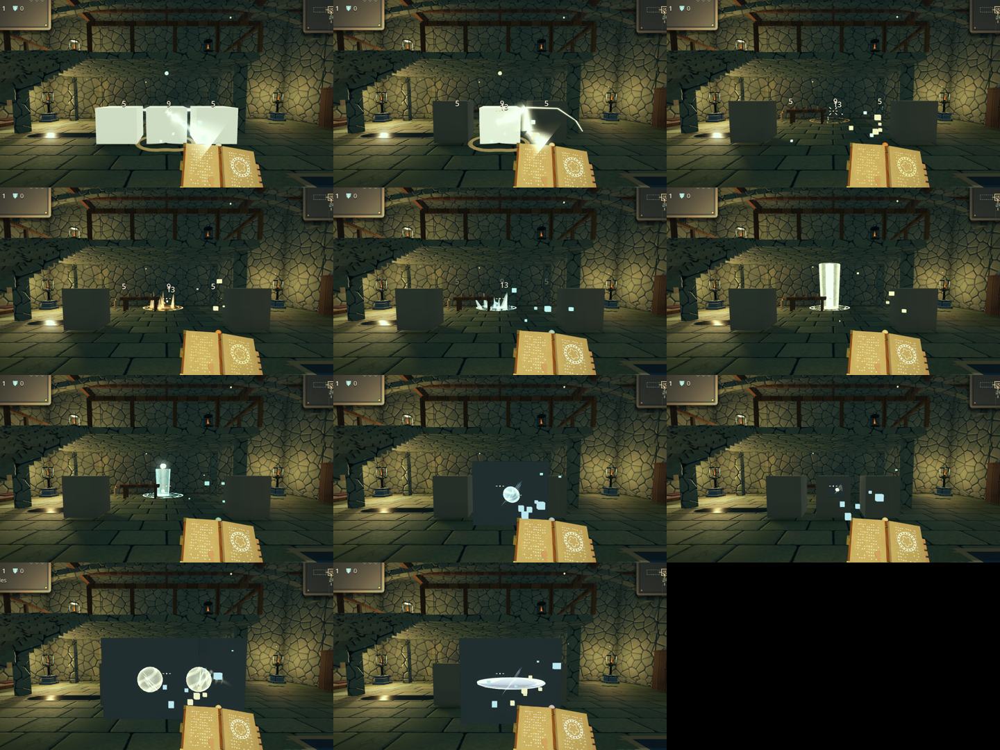

# Spellcraft (experimental)

This branch lets the forge write spellbooks that do more than throw a flying spell, and gives flying spells looks of their own. Every roll is random but stays logical: a kind of spell only takes the elements and traits that make sense for it, and a look suits both its element and its pattern.

## Kinds of spell

Besides the nine flying patterns (bolt, burst, fan, twin, ring, spiral, lance, lob, boomerang) the forge now writes three spells that do not fly:

| Kind | What it does | Elements | Traits it can take |
| --- | --- | --- | --- |
| Ray | An instant beam along your aim. It goes through the same flight a bolt does in one tick, so it stops at walls, pierces, glances off walls, relights lanterns, splits through glass and strikes everything a bolt would, then shows as a beam along the path it really took (bends and ricochets too). | radiance, frost, ember, glass, tide, venom | piercing, ricochet, chaining, splitting, volatile, keen, heavy, kindled |
| Lightning | Strikes the nearest foe within a narrow cone ahead and in sight, at once, as a jagged bolt with branches. With no foe it strikes where you aim, and lightning in water runs through the pool. | storm, radiance | chaining, volatile, splitting, keen, heavy, kindled |
| Eruption | A rune glows on the floor where you aim (under the first foe in the way), then something rises and strikes everything over it. Each element rises its own way: flame tongues, ice spikes, a bolt from above, venom bubbles, a pillar of light, crystal shards, a wax geyser, a waterspout. Water, wax and ice eruptions leave their residue behind. | all eight | lingering (rises twice), growing (wider), seeking (rises under the nearest foe), chaining, splitting (throws glass shards), keen, heavy, kindled |

The four kinds are equally rare: a flying spell (any of its nine patterns), a ray, lightning and an eruption each come up a quarter of the time, in a seed's starters, at merchants, at the boss's reliquary and at Death's altar alike. Starters may hold two of a kind in different elements (two rays, one frost and one ember); no two starters share an element. Each kind is balanced against the same damage budget as before.

## Looks

A flying spell's heart takes one of six shapes, each with its own halo so it reads from behind as well as from the side:

| Look | Shape | Suits |
| --- | --- | --- |
| Orb | A swirling orb in a rune circle (as before) | ember, frost, venom, radiance, wax, tide |
| Shard | A long crystal in a turning diamond | frost, glass |
| Needle | A thin dart in a four-point star, with a long trail | frost, storm |
| Comet | A large orb in a flaring corona, with a long trail | ember, radiance, wax |
| Mote | A small soft spark | storm, venom |
| Disc | A flat disc spinning as it flies | glass, tide |

Patterns narrow it further: a lance is a needle or a shard, a lob an orb or a comet, a boomerang a disc or an orb, and sprays and rings lean to motes and shards.

## Every relic, every spellbook

Every relic and pairing does something whatever the spellbook. Relics that shape a flight mean this for the spells that do not fly:

| Relic power | Ray | Lightning | Eruption |
| --- | --- | --- | --- |
| Pierce | Passes through foes | Carries on to the next foe beyond | Runs on as a fissure of eruptions along your aim |
| Ricochet | Glances off walls | Leaps to another foe near (Ricochet Arc, Mirror Maze answer each leap) | Leaps to rise again under another foe |
| Seeking | Bends toward foes | A wider cone | Rises beneath the nearest foe |
| Weaving | Zigzags | A wilder bolt (Hunter's Moon still finishes the wounded) | A ripple rises wider after it |
| Returning | Turns back to you | Comes back a moment later to strike again (Homecoming: twice as hard) | Another rises at your feet (Homecoming: twice as hard) |
| Lingering | Its beam stays, burning what crosses it | A storm cell keeps striking near where it hit | Rises twice |
| Speed, gathering speed | Reaches farther | Reaches farther | Rises sooner |
| Swelling | Widens as it goes | Strikes those beside its target too | Reaches wider |
| Forking | Splits three ways at its end | Strikes two more foes in a wider cone | Throws three small eruptions around it |
| Trails (Candlemaker, Molten) | Wax laid along the beam | Wax laid along the bolt | Wax where it rises |
| More spells, behind, beside, in a ring | Fans and rings of rays | Bolts that pick different foes | Several eruptions, a ring of them close around you |

Everything that answers a hit (statuses, reactions, splitting, bursting, chains, lifesteal, crits, Lucky Star, Icicle, Starfall) answers a ray's, a bolt's and an eruption's hits too.

## New relics

Twelve new relics. Seven cast spells of their own (echoes, phantoms, lightning from above, prism rays, phoenix eruptions, dash quakes, falling stars) through the same path any spell takes, so they work with every spellbook and in co-op:

| Relic | Rarity | What it does |
| --- | --- | --- |
| Echo Bell | rare | Every cast rings out again a moment later as an echo at 60% |
| War Drum | uncommon | Every fourth cast is a Great Cast: twice the damage, half again as large; cast 10% faster |
| Black Pearl | rare | Every hit drags the foes around it in toward the one struck; 15% more damage |
| Phantom Veil | rare | A phantom at your shoulder casts every spell you do, at 70% |
| Storm Crown | mythic | Three hits in ten call lightning down from above; every hit arcs once more |
| Phoenix Feather | mythic | Fallen foes erupt in flame where they stood (a chain through a pack); spells burn |
| Prism Lens | rare | Every hit throws a ray at the nearest other foe |
| Seismic Boots | uncommon | The floor erupts in your spellbook's element where your dash ends |
| Spyglass | common | Up to 60% more damage the farther off the foe; 25% more reach |
| Meteor Charm | rare | One cast in four calls a falling star down where you aim |
| Fractal Seed | mythic | Spells split in two, and every shard splits again |
| Crimson Grail | dark | Each kill in a room: 8% more damage, up to 80%, until you leave it; 5% lifesteal |

They come with twelve new pairings (Choir, Supercell, Event Horizon, Pyroclasm, Kaleidoscope, Aftershock, Deadeye, Meteor Shower, Legion, Infinite Regress, Blood Moon, Overture), listed in [COMBINATIONS.md](COMBINATIONS.md). Six of them also sing with a spellbook's element (Phoenix Feather with ember, Storm Crown with storm, Prism Lens and Meteor Charm with radiance, Fractal Seed with glass, Black Pearl with tide).

## Sounds

Every spell sounds like what it is, and its sound comes when it happens:

- A flying spell's cast sounds of its element: a crackling whoosh for ember, a glassy chime for frost, a zap for storm, a wobbling bloop for venom, a bell chord for radiance, tinkling pings for glass, a soft plop for wax, a splash for tide. Its look shifts the pitch (motes higher, comets lower).
- A ray fires with a buzzing beam and a whine riding over it; a lingering beam hums while it burns.
- Lightning gathers for a breath (about a tenth of a second) with a rising crackle, and only then strikes with a crack where it lands; lightning from the sky (Storm Crown) is thunder.
- An eruption draws a soft breath as you cast, the ground rumbles louder under its rune until it breaks (a falling star whistles down instead), and then what rises sounds as its element does: a fiery whoomp, cracking ice, thunder, popping bubbles, a choir chord of light, shattering crystal, a gurgling geyser, a splash, or a meteor's boom.
- An Echo Bell's echoes sound again, quieter and a little higher.

Sounds where something lands or rises are placed in the room. Each player's device plays the sounds of the spells it draws itself, so co-op never doubles them. They are synthesised (`scripts/spell_audio.gd`) on a worker thread at start-up, so they cost no loading time.

Every kind of spellbook also breaks crates and barrels: lightning that strikes no foe breaks what it strikes, and an eruption breaks what stands over its rune.

## Compatibility

Forged ids now carry version 2. Version 1 ids (older saves, shops and the dark store's offers in old saves) still rebuild exactly as they were. Lances are no longer named "Ray" or "Beam" in version 2, since rays exist.

In co-op, a guest's rays, lightning and eruptions are cast by the host like any other spell, and every player draws them: the kind and the look travel with the spell as numbers.

## Code

- `scripts/items/forge.gd`: `ARCHETYPES`, `FORMS`, the element and pattern tables for looks, and version 2 rolls.
- `scripts/items/spell_forms.gd`: a cast's kind and look, carried in its stats.
- `scripts/shot.gd`: `trace_ray()`, `strike()`, `erupt_tick()`, and each look's heart (`form_basis()`).
- `scripts/items/spell_shapes.gd`: beams, bolts, ground runes, falling stars and what each element raises.
- `scripts/items/relic_powers.gd`: the relics that cast spells of their own.
- `scripts/items/spell_sounds.gd`: which sound a spell makes and when; `scripts/spell_audio.gd`: how each is synthesised.
- `shaders/shot_beam.gdshader`, `shaders/spell_rune.gdshader`, and the looks' halos in `shaders/shot_glow.gdshader`.

`tests/tower.gd` checks that each kind comes up a quarter of the time in starters and in shops, that every element, trait and look suits its spell (starters, shop and dark-forged spellbooks), that version 1 ids rebuild unchanged, that a ray, lightning and an eruption each strike a foe ahead, that every new relic's power works with every kind of spellbook (phantoms, echoes, falling stars and lightning from above for all four), and the per-kind meanings (piercing and ricochet lightning, eruption fissures and returns, lingering rays). `tests/spell_props.gd` breaks a crate or barrel with each kind of spellbook in a real room and renders every spell sound (real signal, no clipping, all in time). `tests/render_spells.gd` is an opt-in capture; set `EMBERKEEP_SPELLS_CAPTURE`.
