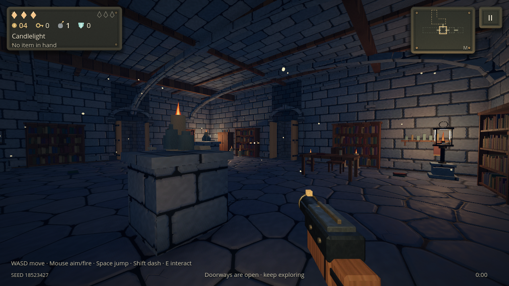
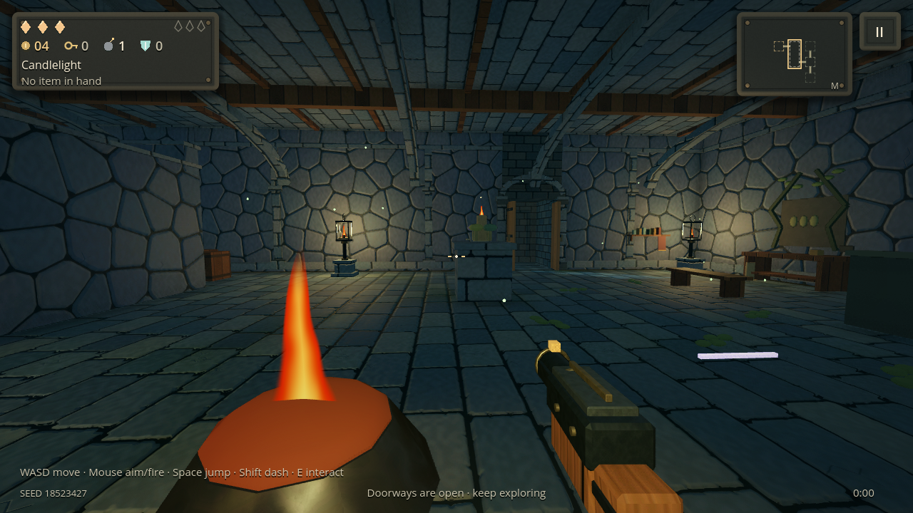
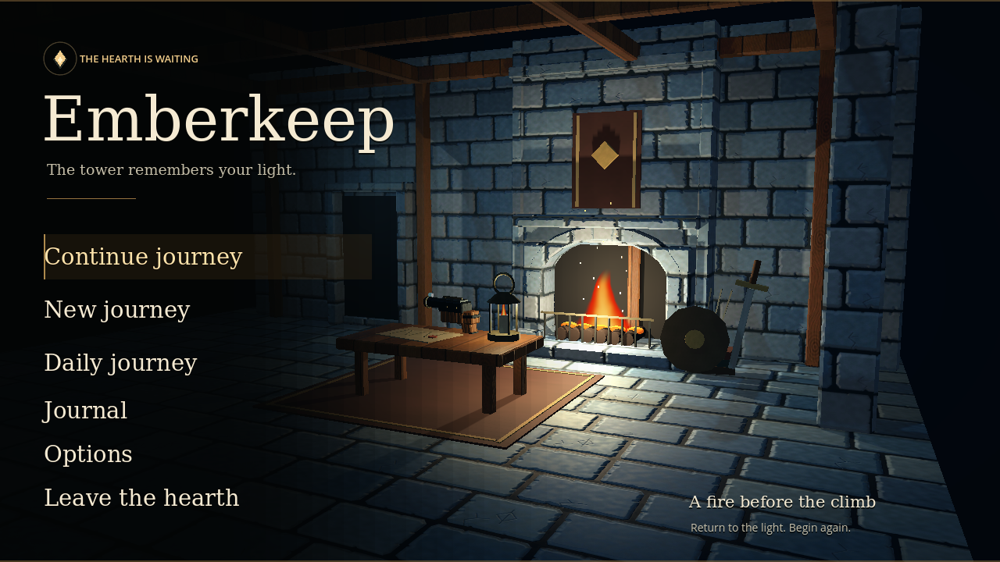
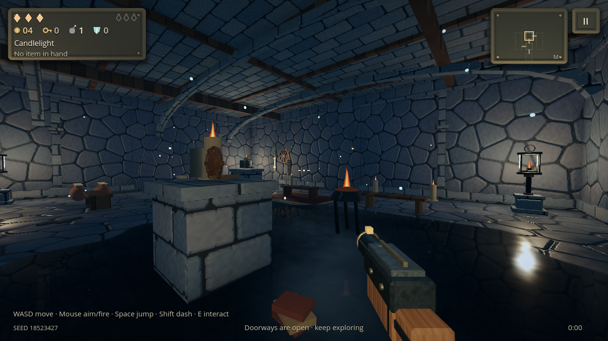

# Carved-light style experiment

Branch: **`experiment/stylized-lighting`**, based on the verified 0.5.0 expedition update. Engine: **Godot 4.7.2 Standard**, Compatibility renderer. The [2 November corridor update](CORRIDOR_UPDATE.md) adds walkable room connections, guaranteed main-route vertical chambers, supported architecture and PowerVR SSAO. Difficulty, chest-only active items, stairs, controls, collections and save format retain their existing rules.

## Art direction

The tower uses large, readable painted forms instead of photographic noise: slate-blue carved stone, restrained warm timber, forged steel and small brass accents. Lanterns and the hearth provide amber light against cooler indirect light. Material depth comes from chipped borders, uneven face planes, incisions, wood cuts and hammer marks, rather than a dark grunge overlay or a flat color tint.

Five original seamless material families replace the scanned runtime set. Their 25 committed maps total **10.00 MiB** in source; the old 23.71 MiB scan set remains available in source and is excluded from this branch's exports. See the [artwork manifest](../assets/materials/stylized/manifest.json) and [authoring notes](../assets/materials/stylized/README.md).

Desktop uses 2K color and normal maps. Android/iOS use 1K derivatives with renormalized normals. A linear RGBA texture packs occlusion, roughness, metal and height. The height field and normals describe the same physical cuts. Mipmaps and anisotropic filtering preserve the artwork at oblique camera angles.

## Shading and lighting

Stone, floors and timber use a short, finite height refinement near the camera. It takes two height samples, fades before distant mips, and never displaces vertices or changes collision. Effects Low and the PowerVR fallback omit these offsets while retaining the authored normal maps and roughness. The ground remains two triangles per section.

Effects changes update existing shared material uniforms immediately, including the held weapon and the title. Changing quality does not rebuild the room, reset the run, or keep an old High material's relief active at Low. Returning to High restores the same material instances.

Small hammered metal details use the same lighting: the held weapon retains its three surfaces and original animation rig. Its separate steel/brass vertex colors remain intact. Furniture, doorways, ceilings, plinths and the title hearth share the surface library.

The existing limit of five local lantern fills and one local shadow spotlight remains. Cooler shadow light is less saturated, and warmer fixtures provide the contrast. Braziers now use the shared turbulent fire shader and dim coals, replacing bright solid flame spheres and additive floor/air halos in first person. Lantern and candle flames occupy a reflected world-effect layer, separate from screen effects.

A single static 128px radiance cube supplies a broad cool vault, pale window and warm bounce for wet stone and forged metal. This is artistic indirect light, not a captured room. The resource and its filtered result are reused when the palette is unchanged.

Standing water additionally supports a real reflected perspective view of the room. The mirror inherits the player's FOV, aspect and lens offsets; it excludes ground, water, first-person weapons and screen passes. Water keeps a single union mask, dark lit body, normal ripples and a restrained Fresnel reflection. The first-person water shader does not sample the screen or a vertex texture.

The extra room render stops in dry rooms and at Effects Low. It is bounded to 25% of the main render size at Balanced and 37.5% at High, within the existing platform limits. At 1280×720 High the mirror is 480×270. Split-level water retains its lit material response without planar reflection: one base-floor mirror cannot correctly represent both elevations.

The Compatibility renderer dropped lit opaque surfaces when the mirror's shadow atlas was disabled with size zero. A **256px atlas with one 128px spotlight tile** supplies a valid bounded target; no new shadow lights or cube shadows are added. The native review now checks detail in the mirror image itself, in addition to testing its projection mathematically. The fixed fixture contains 21,161 surface edges; the broken image contained only 595 edges from its sky boundary and small flames.

The PowerVR GLES policy keeps reflections/radiance, refraction and glow off, mobile MSAA disabled, and the existing 1280×720 pixel budget. The 2 November update enables depth-based SSAO with a six/eight-sample budget independent of color post-processing. It also receives the authored artwork, normal detail, material roughness, fixture lighting and flame shaders. No Vulkan requirement or runtime asset downloads are added.

## Review

The screenshots below are native eye-level Godot captures of generated rooms, with collision-clear camera positions and frozen encounters.









The final export CI passed the complete **31-suite** regression run with **161,771 checks and zero failures**, including original gameplay/save/navigation coverage and **48 stylized-lighting checks**. The material suite passed 178 checks. Android, Linux and iOS resource packs loaded the complete catalog and all required material assets, then each ran 240 quickstart frames. The exported Linux pack also completed 180 frames with the real OpenGL renderer without script, shader or framebuffer errors.

Native Compatibility review covered five generated rooms under desktop and simulated PowerVR policies, plus the title and the water on/off comparison. At the captured viewpoints, the safe policy used approximately **23.65–23.66 MB** of texture memory and **30.6–31.0 MB** total video memory; desktop used approximately **78.3 MB** textures and **85–86 MB** video memory. These are renderer measurements, not source JPEG sizes or estimates of Android FPS.

The five-scene tables measure each composed room before the extra broad comparison pool is added; the active planar mirror adds its own rendering cost. [Desktop measurements](reports/stylized-desktop.json), [safe-policy measurements](reports/stylized-mobile-safe.json) and [reflection comparison](reports/stylized-reflection.json) are recorded separately.

## Verified test builds

All three workflows succeeded for source **`ddea955674d1ac389b8b44592083a0abbe0a5635`** on 1 November 2026. The downloaded ZIPs passed GitHub artifact-digest and CRC checks; the extracted files match their recorded SHA-256 hashes.

| Platform | Download |
| --- | --- |
| Android Preview APK | [Emberkeep-Preview](https://github.com/Halty323/emberkeep/actions/runs/41359115137/artifacts/13104672585) |
| Windows x86-64 | [Emberkeep-Windows](https://github.com/Halty323/emberkeep/actions/runs/41359118538/artifacts/13103659612) |
| Linux x86-64 AppImage | [Emberkeep-Linux-AppImage](https://github.com/Halty323/emberkeep/actions/runs/41359121651/artifacts/13104652810) |

The Preview APK is **0.5.0-android.100011**, package **`org.emberkeep.preview`**, so it can be installed alongside the regular game. It uses the existing cached development certificate `4cf9cd28712f39670ea845ace110dba80c756a07db3bdfc264f3d560605bf3a9`. The downloaded APK's SHA-256 is `9ae357a7434afef77ee051b50a6a1379b0262cc050097c98e5f3ca94b245bf19`; its packaged catalog has no errors and its 240-frame quickstart passed.

Downloads are ZIP artifacts retained until 8 November 2026. After that, dispatch the existing workflow with this branch selected to rebuild them. The game source and screenshots remain on the branch.

## Reproduce

No Python packages are required to play or export the committed project. Authoring-only asset verification uses Pillow:

```sh
python3 tools/bake_stylized_materials.py --check
GODOT_BIN=/path/to/Godot_4.7.2 bash tools/test.sh
GODOT_BIN=/path/to/Godot_4.7.2 bash tools/verify_pack.sh
```

On a machine with an OpenGL display and disposable XDG user storage:

```sh
EMBERKEEP_STYLE_CAPTURE=/tmp/emberkeep-style godot --path . --audio-driver Dummy --script res://tests/render_stylized.gd
EMBERKEEP_STYLE_CAPTURE_POLICY=powervr EMBERKEEP_STYLE_CAPTURE=/tmp/emberkeep-style-safe godot --path . --audio-driver Dummy --script res://tests/render_stylized.gd
```

The capture writes five scene PNGs and JSON resource measurements. The desktop path also writes water with reflection on/off and the mirror camera itself. `EMBERKEEP_STYLE_SCENE=mosslit-hall` restricts review to one room; `EMBERKEEP_STYLE_REFLECTION_ONLY=1` selects the water comparison. `tests/render_title.gd` supplies the home/preparation captures.

Desktop software rendering verifies shader paths and bounds; resource measurements are not phone frame-rate measurements. Physical Android appearance and sustained performance still need device playtesting.
