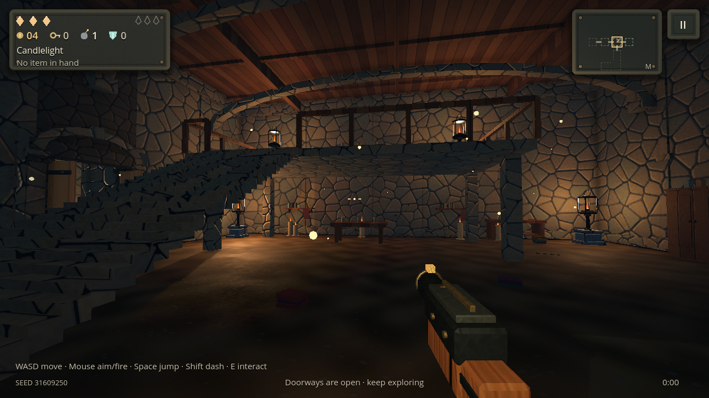
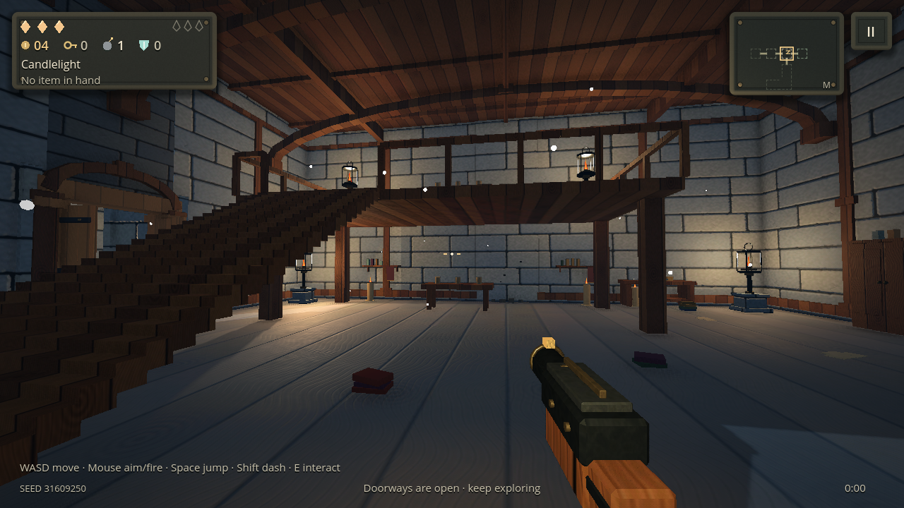
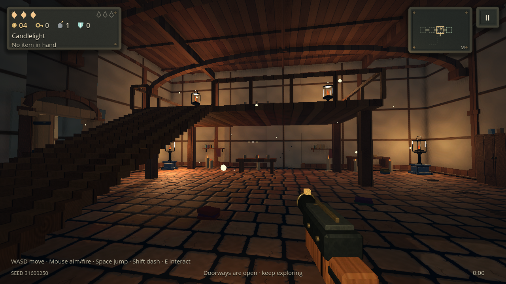

# Distinct materials for each floor

The general carved-material update had reduced most architecture to the same masonry or split-rock sheets. The earlier theme-specific source art remained packaged, but first-person walls no longer selected it. This update restores a separate material identity for each dungeon theme while retaining the current lighting, SSAO, relief, reflections and proper two-storey rooms.

Each floor now has independently authored wall and ground forms, with matching color, normals, cavity occlusion, roughness, metal and height. These are structural differences in the artwork, rather than eight color variations of one brick sheet.

| Floor | Walls | Ground | Ceiling |
| --- | --- | --- | --- |
| [Waking Cellar](images/theme-cellar.png) | Warm rubble | Packed earth and embedded stone chips | Timber |
| [Drowned Cistern](images/theme-cistern.png) | Long water-worn stone courses | Rounded river cobbles | Vault stone |
| [Mosslit Halls](images/theme-halls.png) | Split overgrown stone | Large broken flagstones | Vault stone |
| [Candle Crypt](images/theme-crypt.png) | Diamond-cut memorial blocks | Incised burial slabs | Memorial stone |
| [Frostbound Archive](images/theme-archive.png) | Pale ashlar | Silvered, frost-dusted boards | Timber |
| [Ashen Kiln](images/theme-kiln.png) | Small firebricks | Fractured charcoal basalt | Firebrick |
| [Clockwork Belfry](images/theme-belfry.png) | Riveted hammered iron | Timber with brass inlay | Timber |
| [Last Hearth](images/theme-hearth.png) | Plaster and exposed timber | Terracotta paving | Timber |

The floor's material definition also reaches partitions, gallery supports, stairs, doorways and corridors. Upper gallery paving matches the ground-floor theme. Archive, Belfry and Hearth galleries use timber supports; the other themes use their own stonework. Existing saves pick up the materials from the current content definitions without regenerating rooms or changing collision, rewards or progression.

## Asset and runtime budgets

The extension contains 16 surfaces / 80 maps, with **2048×1024** desktop color/normal maps and **1024×512** mobile derivatives. Mobile normals are renormalized after downsampling. A shared linear **1024×512 ORMH** map stores occlusion, roughness, metallic and height per surface. The 23.86 MiB of source artwork is original deterministic Emberkeep artwork; it uses no downloaded or photographic inputs. The old common five-family set remains available for shared props and fallback materials.

The architecture cache retains the active floor's two surfaces. A floor change evicts previous theme entries from the material, texture and doorway caches; old meshes keep their own references only until their room is freed. This avoids accumulating all eight floors in video memory. The existing five-fill / one-shadow room budget and conservative PowerVR path remain in place. No geometry, additional render passes or lights are introduced by this change.

The new `themed_materials` suite checks **195 conditions** against the actual constructed room, upstairs floor, ceiling, supports and live corridor. It verifies distinct bound texture data, cached-material reuse, bounded caches, fallback materials, unchanged gameplay RNG and saved two-storey blueprints. The offline baker verifies every committed map's hash, dimensions and physical channels.

To verify the source art:

```sh
python3 tools/bake_theme_materials.py --check
```

To run the scene/material tests with disposable profile storage:

```sh
XDG_DATA_HOME="$(mktemp -d)" godot --headless --path . --script res://tests/themed_materials.gd
```

For native screenshots of the same two-storey chamber in all eight themes, run that script on an OpenGL display with `EMBERKEEP_THEME_CAPTURE` set to an absolute output directory. It uses the simulated Android/PowerVR Compatibility policy. Desktop software-renderer checks do not establish physical-phone performance.

## Native comparison

All eight views use the same generated two-storey chamber under the simulated PowerVR policy. Texture memory stayed at **34.83 MB** throughout all eight rebuilds; reported video memory ranged **42.15–42.79 MB**, with **418–465 draw calls**. The cache contained two theme surfaces in every view. These are desktop Mesa resource measurements, not a physical-phone benchmark. [Measurements](reports/themed-material-native.json).






