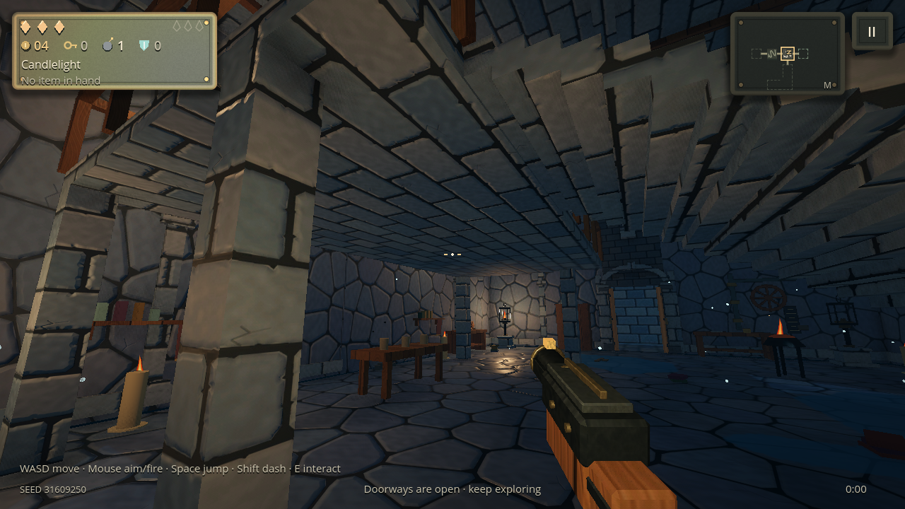
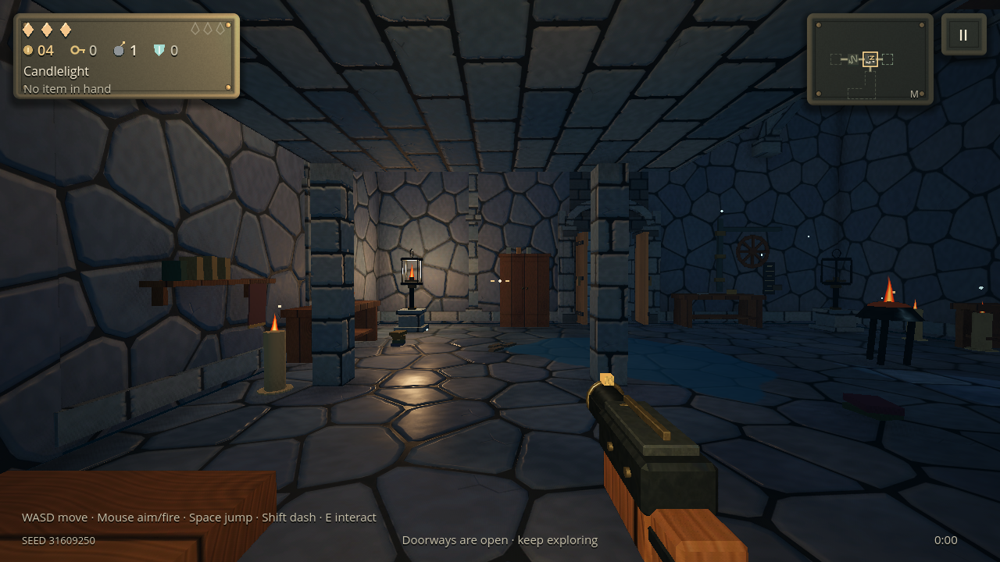
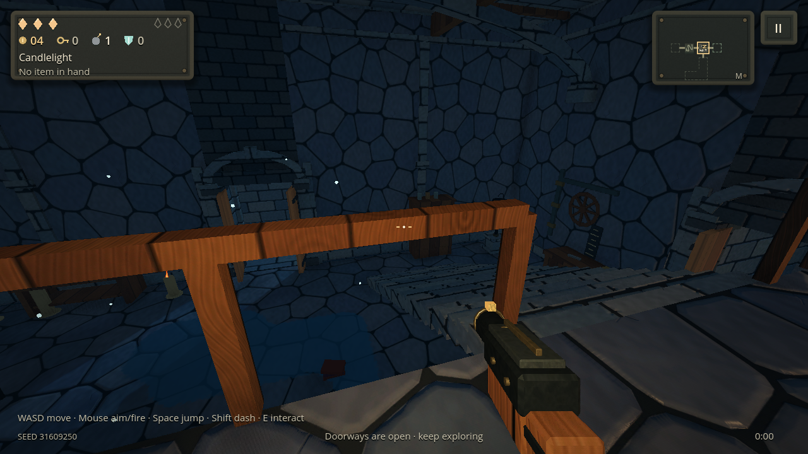

# Proper two-storey chambers

The earlier primary rooms were raised annexes backed by solid foundations. They did not provide an upstairs floor above usable ground-floor space. This update replaces the primary annex with a saved version-3 loft blueprint on `experiment/stylized-lighting`.

Each new first-person floor places a real two-storey combat chamber on every normal route to the boss. The generator removes bypassing cycle connections while retaining the connected floor, optional branches and concealed secrets. This is checked against the actual portal graph, rather than a room flag or one chosen shortest path.

The upper gallery is 10 × 5 metres, 3.2 metres above the ground. The room has a 7.4-metre ceiling, a thin solid slab, supporting columns, grounded railings and a broad staircase. Both floors contain furniture and lantern fixtures. The existing encounter places some enemies upstairs; clearing the chamber awards a normal chest upstairs. Equipment probability and active-item restrictions remain governed by the existing chest rules.







## A whole second storey

A two-storey room's upper floor now covers the room's entire footprint, every cell, except the stairwell. It is a solid slab 3.2 metres up, held up by a grid of stone columns with timber capitals, with paving on top and a stone ceiling below. The ground floor keeps its furniture, wall dressing and lanterns under the slab. Upstairs has its own lanterns along the walls (two a cell, six at most) and a table in each cell; some foes start up there, and the earned chest appears there.

The staircase can climb north, south, east or west, so it can run along a quiet wall in a room with doorways on several sides. A railing surrounds the stairwell on every side except its top landing. Upstairs navigation keeps paths off the rail and steps into the flight only from the landing. A doorway's ornamental arch is left off, so nothing pokes up through the floor above, and any small dressing tall enough to pierce the slab is left out.

Every combat room that rolls a second level gets this whole-floor layout, about two a floor. A room whose stairs cannot fit clear of its doorways stays flat. On older saves, untouched rooms with a ramp annex, sunken cellar or 10 × 5 gallery become a whole-floor room, or flat where one cannot fit. Rooms already entered keep what they had. On legacy floors, the primary chamber is now chosen among rooms that the boss route can be made to pass through.

## Movement, combat and persistence

Height queries now distinguish feet above and below the same slab. Players can walk underneath the gallery, climb upstairs and descend without being snapped through the floor. Enemy routes use a separate navigation grid for each storey, joined at the staircase. Replanning during descent completes the stair leg instead of repeatedly sending enemies back upstairs. Static collision and sight tests prevent attacks through the slab.

Each storey has its own residue mask and cloud collection, allocated only when needed. Water, moss, fire and clouds at the same horizontal position remain independent. Pickups preserve their height through spawning and save records, and chest obstacles are assigned to their floor. Discovered two-storey chambers receive a staircase mark on the map and an arrival message.

Untouched eligible rooms in old checkpoints can receive the architecture upgrade without replacing visited rooms, opened chests or the saved portal graph. Future floors of old runs also receive real storeys while retaining their saved generator/economy version. Existing visited annexes remain intact.

## Verification

The focused suite passes **113 checks**. `tests/two_storey.gd` exercises a fresh run with seed **31609250**, walks through its actual corridors to the chamber, checks upstairs encounter placement and clears the real encounter to award its chest. It then physically walks under the slab, climbs upstairs, walks beside the chest and descends. A real enemy follows upstairs and back down; ranged and clockwork enemies also reach the upper floor without snagging at the stair foot. Additional checks cover separate residue/cloud layers, pickup persistence, multiple seeds and legacy-run continuation.

The native Godot 4.7.2 captures above use the simulated Android/PowerVR Compatibility policy, including bounded SSAO. They use the actual main scene and the same physical traversal test. The capture measured **27.46 MB of texture memory**, **34.40–34.46 MB of video memory**, and **238–331 draw calls** across these views. These desktop Mesa measurements describe resource use; they do not establish frame rate or stability on a physical PowerVR device. [Native measurements](reports/two-storey-native.json).

To reproduce the physical test with disposable profile storage:

```sh
XDG_DATA_HOME="$(mktemp -d)" godot --headless --path . --script res://tests/two_storey.gd
```

For the three native screenshots, run the same script on an OpenGL display and set `EMBERKEEP_STOREY_CAPTURE` to an absolute output directory. Three-dimensional drawing is enabled for each captured view and disabled during intervening physics traversal to keep software rendering from slowing the test. The full runner is `GODOT_BIN=/path/to/godot bash tools/test.sh`.

## Verified builds

Android, Windows and AppImage CI each passed **33 suites / 167,356 checks with zero failures** for source `a08465090fa4777ad130c7fb3ab1138e6f7a7032`. Both APKs passed catalog validation and 240 packaged quickstart frames. All four downloaded archives passed GitHub digest and ZIP CRC verification; extracted binaries matched their recorded hashes. Android version **0.5.0-android.100014**, code **100014**, retains the existing development signing certificate. [Hashes and build metadata](reports/two-storey-builds.json).

- [Android APK](https://github.com/Halty323/emberkeep/actions/runs/41469743723/artifacts/13155561515)
- [Separately installable Android Preview](https://github.com/Halty323/emberkeep/actions/runs/41469743723/artifacts/13155526763)
- [Windows executable](https://github.com/Halty323/emberkeep/actions/runs/41469767153/artifacts/13154388928)
- [Linux AppImage](https://github.com/Halty323/emberkeep/actions/runs/41469787137/artifacts/13154193201)

GitHub artifacts have seven-day retention. To see the chamber immediately in this build, start a new run with seed **31609250**: its first combat room has the two-storey gallery. The arrival view above is taken after walking there through the normal corridor.
